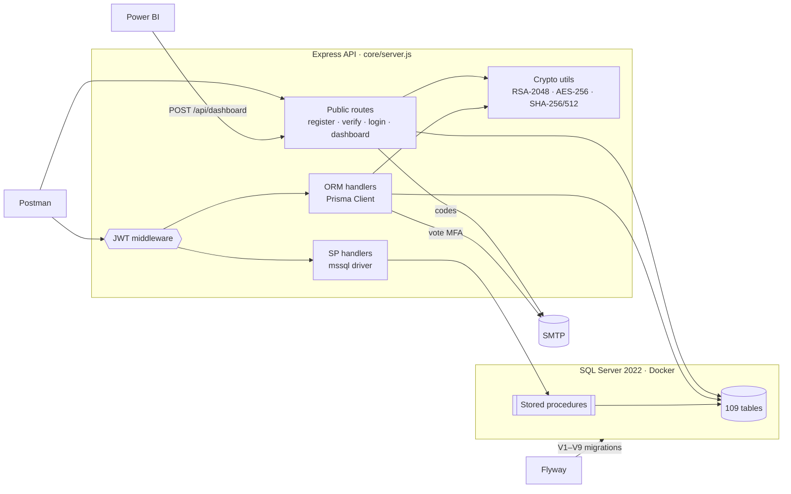
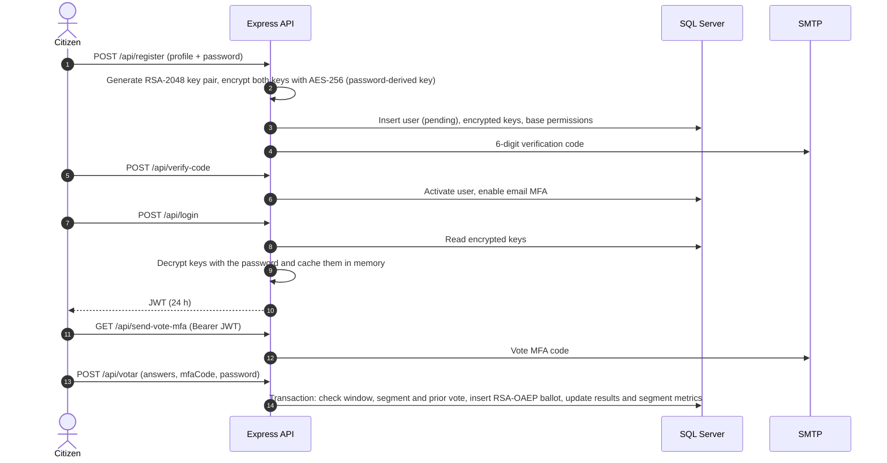
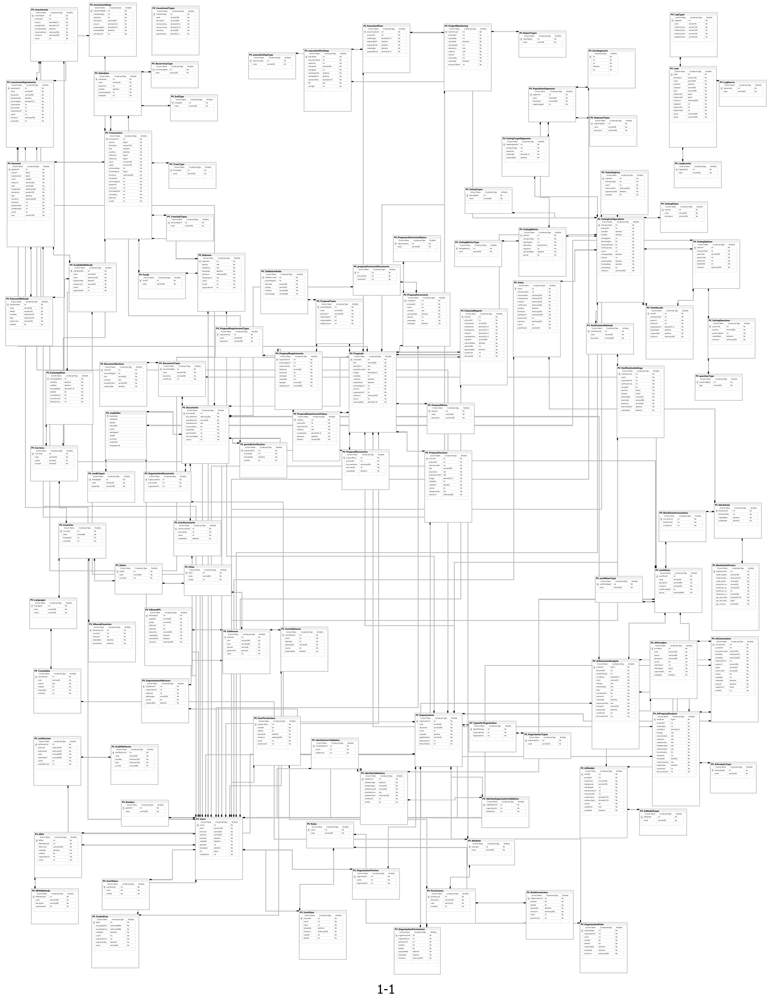

# Voto Pura Vida 🇨🇷

Backend for a Costa Rican e-voting and civic crowdfunding platform: citizens submit proposals, vote on them with encrypted ballots and email MFA, and invest in the ones that get approved. Built with Node.js, Express, Prisma and SQL Server.

University team project (Costa Rica, May–June 2025). The focus is the data layer: a 109-table SQL Server schema versioned with Flyway, business logic implemented both with Prisma ORM and with T-SQL stored procedures, and application-level cryptography for user keys and votes. There is no web frontend: the API is exercised with the included Postman collections and a Power BI dashboard.

<p>
  <a href="LICENSE"></a>
  
  
  
  
  
  
  
  
  
  
  
  
  
</p>

---

## Table of Contents
- [Features](#features)
- [Authors](#authors)
- [Architecture](#architecture)
- [API Endpoints](#api-endpoints)
- [Technology Stack](#technology-stack)
- [Database Architecture](#database-architecture)
- [Project Structure](#project-structure)
- [How To Run](#how-to-run)
- [Testing](#testing)
- [What I Learned](#what-i-learned)
- [License](#license)

---

## Features
* **Citizen accounts with per-user cryptography** – registration generates an RSA-2048 key pair, encrypted with AES-256 using the user's password. Login proves the password by decrypting those keys and returns a 24 h JWT.
* **Email verification and MFA** – 6-digit, time-windowed codes (SHA-256 of email + 10-minute window + server secret, never stored), sent with Nodemailer to activate the account and before every vote.
* **Proposals** – create and update with versioning, attached documents and weighted target population segments. Creating a proposal also sets up its voting configuration, execution plan and investment agreement. A review procedure runs a simulated AI analysis of the proposal and its documents.
* **Configurable votings** – questions, options, voting type, date window and weighted target segments. Catalog values can be sent by name (e.g. `"Votación Ponderada"`), and invalid values return the list of valid options.
* **Encrypted ballots** – one vote per user per voting, MFA code + password required, ballot encrypted with RSA-OAEP, and results plus per-segment metrics updated in a single transaction. Users can decrypt and read back their last 5 votes, and every read is logged.
* **Moderated comments** – comments with attachments go through structure, validity and (optional) encryption workflows and end up approved or rejected, with the reasons logged.
* **Civic crowdfunding** – invest in approved proposals (equity % computed from the budget and the requested percentage; payment, transaction and investment-step records) and distribute dividends to investors in proportion to their equity, based on approved financial reports and audits.
* **Power BI dashboard** – an authenticated endpoint backed by `SP_Dashboard` feeds Power BI with the 5 most recent votings (votes per option and segment) and requested vs. invested vs. executed amounts.
* **Audit trail** – SHA-256/512 checksums on sensitive rows and `PV_Logs` entries for workflows, vote reads, payments and errors.

---

## Authors
* **Isaac Villalobos Bonilla** – [@IsaacVil](https://github.com/IsaacVil) – authentication and email MFA, cryptography utilities and vote-listing endpoints
* **Allan David Bolaños Barrientos** – [@AllanDBB](https://github.com/AllanDBB) – Prisma schema, voting endpoints, server setup, seeding
* **Daniel Arce Campos** – [@DArceCampos](https://github.com/DArceCampos) – proposal creation and review procedures and endpoints, ER diagram
* **Natalia Orozco Delgado** – [@natiorozco](https://github.com/natiorozco) – investment and dividend stored procedures, Power BI dashboard

**My role:** I worked on authentication and email MFA (registration, account verification, JWT login and the time-windowed email codes), built the cryptography layer (per-user RSA-2048 key generation, AES-256 encryption of the keys with the user's password, and the session cache that holds the decrypted keys), and wrote the `listarvotos` endpoint, which decrypts and returns a user's own votes.

---

## Architecture
A single Express API whose handlers follow a serverless style: each file in `core/api` exports a `(req, res)` function, and `core/server.js` mounts them as routes. Two data-access approaches are used side by side:

* **ORM handlers** (`core/api/orm`) use Prisma Client, with `$transaction` for multi-step operations such as voting.
* **Stored-procedure handlers** (`core/api/stored-procedures`, plus `repartirDividendos`) use the `mssql` driver to call T-SQL procedures that hold the business rules and their transactions.



### Secure voting flow


---

## API Endpoints
Base URL: `http://localhost:3000`. Protected routes expect `Authorization: Bearer <token>` from `/api/login`.

| Method | Endpoint | Auth | Data access | Description |
|---|---|---|---|---|
| POST | `/api/register` | – | mssql | Creates the user, generates and encrypts the RSA keys, assigns base permissions, emails a verification code |
| POST | `/api/verify-code` | – | mssql | Validates the code, activates the account and enables email MFA |
| POST | `/api/login` | – | mssql | Checks the password by decrypting the user's keys, returns a JWT |
| POST | `/api/dashboard` | email + password in body | `SP_Dashboard` | Dashboard dataset for Power BI (admin roles only) |
| GET | `/api/send-vote-mfa` | JWT | – | Emails a vote MFA code |
| POST | `/api/asignar-segmentos` | JWT | Prisma | Assigns population segments to the user (required before voting) |
| POST, GET | `/api/crearActualizarPropuesta/:id` | JWT | `crearActualizarPropuesta` | `/0` creates a proposal, `/{id}` updates it as a new version; GET returns its details |
| POST | `/api/revisarPropuesta` | JWT | `revisarPropuesta` | Runs the simulated AI review of a proposal and its documents |
| POST, GET | `/api/comentar` | JWT | Prisma | POST adds a comment with documents; GET `?proposalid=` returns the user's latest comment with its workflow logs |
| POST | `/api/configurarVotacion` | JWT | Prisma | Lets the proposal's creator configure a voting: dates, type, questions, options, target segments |
| POST | `/api/votar` | JWT + MFA + password | Prisma | Casts an encrypted vote |
| POST | `/api/listarvotos` | JWT | Prisma | Decrypts and returns the user's last 5 votes |
| POST, GET | `/api/invertirEnPropuesta` | JWT | `PV_InvertirEnPropuesta` | Invests in an approved proposal; GET lists its investments |
| POST, GET | `/api/repartirDividendos` | JWT | `sp_PV_RepartirDividendos` | Distributes dividends to investors; GET shows available funds and previous payouts |
| POST | `/api/crearReporteFinanciero` | Bearer token (dev only) | mssql | Development helper that creates an approved financial report and audit record |

Example bodies for every request are in [`core/postman/VotoPuraVida.postman_collection.json`](core/postman/VotoPuraVida.postman_collection.json).

---

## Technology Stack

### Backend Services
* Node.js + Express 4
* Prisma ORM 6 (SQL Server provider) for the ORM endpoints
* `mssql` driver for queries and stored-procedure calls
* `jsonwebtoken` for JWT auth
* Node `crypto`: RSA-2048 / RSA-OAEP, AES-256-CBC, SHA-256/512
* Nodemailer (SMTP) for verification and MFA emails

### Frontend
* No web frontend. The API is consumed through Postman and Power BI.

### Database
* Microsoft SQL Server 2022 running in Docker
* T-SQL stored procedures for proposals, reviews, investments, dividends and the dashboard
* Flyway for versioned migrations

### Development & Deployment
* Docker (`mssql/server` and `flyway/flyway` images)
* nodemon for local development
* Postman collections for manual API testing
* Power BI Desktop / Service for the dashboard
* `vercel.json` is included for a serverless deployment (see [Notes](#notes))

---

## Database Architecture
* **Engine:** SQL Server 2022. T-SQL procedures with `TRY…CATCH` and explicit transactions carry the financial flows, and Power BI connects to the data through the API.
* **Size:** 109 tables (all prefixed `PV_`) with 160+ foreign keys. Prisma Client is generated from the live database by introspection (`core/prisma/schema.prisma`).
* **Main domains:**

| Domain | Main tables |
|---|---|
| Users & security | `PV_Users`, `PV_UserStatus`, `PV_Roles`, `PV_Permissions`, `PV_UserRoles`, `PV_UserPermissions`, `PV_CryptoKeys`, `PV_MFA`, `PV_authSession`, `PV_IdentityValidations` |
| Organizations | `PV_Organizations`, `PV_OrganizationTypes`, `PV_OrganizationPerUser`, `PV_OrganizationRoles`, `PV_OrganizationPermissions` |
| Proposals | `PV_Proposals`, `PV_ProposalVersions`, `PV_ProposalStatus`, `PV_ProposalTypes`, `PV_ProposalRequirements`, `PV_ValidationRules`, `PV_ProposalComments`, `PV_Documents`, `PV_mediafiles` |
| Voting | `PV_VotingConfigurations`, `PV_VotingQuestions`, `PV_VotingOptions`, `PV_Votes`, `PV_VoteResults`, `PV_VotingMetrics`, `PV_VotingTargetSegments`, `PV_PopulationSegments`, `PV_UserSegments` |
| Crowdfunding & finance | `PV_Investments`, `PV_InvestmentAgreements`, `PV_investmentSteps`, `PV_ExecutionPlans`, `PV_ProjectMonitoring`, `PV_FinancialReports`, `PV_Payment`, `PV_Transactions`, `PV_Currency`, `PV_ExchangeRate` |
| AI, workflows & blockchain | `PV_AIProviders`, `PV_AIModels`, `PV_AIConnections`, `PV_AIProposalAnalysis`, `PV_AIDocumentAnalysis`, `PV_workflows`, `PV_blockchain` |
| Audit | `PV_Logs`, `PV_LogTypes`, `PV_LogSource`, `PV_LogSeverity` |
| Geography & i18n | `PV_Countries`, `PV_States`, `PV_Cities`, `PV_Addresses`, `PV_Languages`, `PV_Translation`, `PV_AllowedCountries`, `PV_AllowedIPs` |

* **Migrations** (`scripts/`):

| Script | Content |
|---|---|
| `V1__creation.sql` | Full schema: 108 tables, primary and foreign keys |
| `V2__alters.sql` | Adjustments: investment ownership, `percentageRequested`, `PV_InvestmentTypes`, per-option vote counters |
| `V3__InvestmentSP.sql` | `PV_InvertirEnPropuesta` |
| `V4__repartirDivendos.sql` | `sp_PV_RepartirDividendos` |
| `V5__CrearActualizarPropuestaSP.sql` | `crearActualizarPropuesta` |
| `V6__RevisarPropuestaSP.sql` | `revisarPropuesta` |
| `V7__seeding.sql` | Reference data: geography, roles and permissions, catalogs, population segments, AI providers and workflows, admin users |
| `V8__seedingForDashboard.sql` | Demo data: users, segments, proposals with votings and metrics, investments |
| `V9__dashboardSP.sql` | `SP_Dashboard` |

* **ER diagram** (click to open it full size; the original is [`Diagrama.pdf`](Diagrama.pdf)):

<p align="center">
  <a href="docs/er-diagram.png"></a>
</p>

---

## Project Structure
```text
Voto-Pura-Vida/
├── core/                         # Node.js API
│   ├── api/
│   │   ├── auth/middleware.js    # JWT verification
│   │   ├── orm/                  # Auth, voting, comments, segments, dividends
│   │   ├── stored-procedures/    # Proposals, review, investments, financial report
│   │   └── dashboard/            # Power BI data endpoint
│   ├── prisma/schema.prisma      # Introspected database schema
│   ├── postman/                  # Postman collections
│   ├── src/
│   │   ├── config/               # mssql pool, Prisma client, app config
│   │   ├── utils/                # Crypto, session cache, email service and templates
│   │   └── generated/prisma/     # Committed Prisma client (Windows engine)
│   ├── server.js                 # Express app and routes
│   ├── index.js                  # Serverless entry point
│   ├── update-sp.js              # Re-applies the proposal stored procedure
│   ├── vercel.json
│   └── package.json
├── scripts/                      # init.sql + Flyway migrations V1–V9
├── dashboard/                    # SP_Dashboard, test data and Power BI guide
├── docs/er-diagram.png           # ER diagram as an image (shown in this README)
├── Diagrama.pdf                  # ER diagram (original PDF)
├── flyway.conf
├── LICENSE
└── README.md
```

---

## How To Run

### Prerequisites
* Docker
* Node.js 18.18+ (20 LTS recommended) and npm
* An SMTP account for verification and MFA emails (e.g. Gmail with an app password)
* Postman, and optionally Power BI Desktop

### Quick start
Run these from the repository root. The commands work in both bash and PowerShell.

```bash
# 1. Start SQL Server (host port 14333 -> container 1433)
docker run -e "ACCEPT_EULA=Y" -e "MSSQL_SA_PASSWORD=VotoPuraVida123#" -p 14333:1433 --name votopuravidaSQL -d mcr.microsoft.com/mssql/server:2022-latest

# 2. Create the database (init.sql is not a Flyway migration)
docker exec votopuravidaSQL /opt/mssql-tools18/bin/sqlcmd -S localhost -U sa -P "VotoPuraVida123#" -C -Q "CREATE DATABASE VotoPuraVida"

# 3. Apply migrations V1–V9 with Flyway (uses flyway.conf)
docker run --rm --add-host=host.docker.internal:host-gateway -v "${PWD}/scripts:/flyway/sql" -v "${PWD}/flyway.conf:/flyway/conf/flyway.conf" flyway/flyway migrate

# 4. Install the API and generate the Prisma client
cd core
npm install
npm run prisma:generate
```

Create `core/.env`:

```env
NODE_ENV=development
PORT=3000

# SQL Server (mssql driver). Quote the password: an unquoted "#" starts a comment.
DB_SERVER=localhost
DB_PORT=14333
DB_NAME=VotoPuraVida
DB_USER=sa
DB_PASSWORD="VotoPuraVida123#"
DB_ENCRYPT=false
DB_TRUST_CERTIFICATE=true

# Prisma
PRISMA_DATABASE_URL="sqlserver://localhost:14333;database=VotoPuraVida;user=sa;password=VotoPuraVida123#;trustServerCertificate=true"

# Secrets (the code has development defaults; set your own)
JWT_SECRET=change-me
VERIFICATION_SECRET=change-me

# SMTP for verification and MFA emails
SMTP_HOST=smtp.gmail.com
SMTP_PORT=587
SMTP_EMAIL=your-account@gmail.com
SMTP_PASSWORD=your-app-password
```

Start the API:

```bash
npm run dev            # nodemon on http://localhost:3000
# or
npm run start:server   # plain node
```

### Trying it with Postman
Import `core/postman/VotoPuraVida.postman_collection.json`. Its folders follow the usage order: **Autenticación** → **Usuario** → **Propuestas** → **Votaciones** / **MFA** → **Inversiones**. After **Iniciar con Usuario**, put the returned token in the Bearer auth of the protected requests. Before **Votar**, the user needs:
1. an active segment (**Asignar segmentos**),
2. a voting with questions and options (**Configurar votación**; its pre-request script sets the start date to one second from now so the voting opens right away),
3. a fresh code from **MFA-Email**.

### Notes
* Ports: API `3000`; SQL Server `14333` on the host.
* Several modules hard-code the connection (`localhost:14333`, database `VotoPuraVida`, user `sa`, password `VotoPuraVida123#`), so keep the database set up exactly as above.
* Use `npm run dev` or `npm run start:server`. `npm start` runs `index.js`, which does not start the full API.
* On Linux, the Flyway container needs `--add-host=host.docker.internal:host-gateway` (already in the command above) to reach SQL Server on the host.

**Known issues**
* `comentar` and `listarvotos` import the Prisma client committed in `core/src/generated/prisma`, which was generated on Windows. On Linux/macOS, regenerate it into that folder: add a second generator with `output = "../src/generated/prisma"` to `core/prisma/schema.prisma` and run `npm run prisma:generate` again.
* `/api/send-verification-code` is mapped to a function name that `verify.js` does not export, so the route fails. Registration already emails the code, and `/api/verify-code` works.
* `vercel.json` targets `api/**/*.ts`, but the handlers are `.js`, so the Vercel config needs updating before a deploy.
* The AI and document workflows are simulated: the procedures and endpoints log each workflow call and auto-approve. `comentar` takes the workflow results as flags in the request body.

---

## Testing
There are no automated tests (Jest is listed as a dev dependency but no tests were written). Testing was done manually:

* **API:** the Postman collections in `core/postman/` cover every endpoint with example bodies.
* **Database:** `V7__seeding.sql` and `V8__seedingForDashboard.sql` load reference and demo data so the stored procedures and the dashboard can be run immediately. `dashboard/Dashboard.sql` and `dashboard/testing.sql` are copies of V9 and V8.
* **Dashboard:** [`dashboard/dashboard.md`](dashboard/dashboard.md) explains how to connect Power BI to `POST /api/dashboard` with email and password parameters and how to publish the report without data export.

---

## What I Learned
* **Protecting keys with only the user's password.** Each user gets an RSA-2048 key pair. Both keys are encrypted with AES-256-CBC, using a key derived from the password and a random IV stored in front of the ciphertext. Login works by decrypting those keys, so the database never holds the password or a usable private key. Next time I would derive the key with a salted KDF (PBKDF2, scrypt or Argon2) instead of a single SHA-512, and keep a separate password hash.
* **ORM vs. stored procedures.** Building the same domain in both styles showed the trade-off. Prisma transactions keep multi-step logic such as voting and comments readable in JavaScript. T-SQL procedures with explicit transactions fit money flows such as investments and dividends better, because everything must commit or roll back together close to the data.
* **Migrations on a large schema.** Versioning a 109-table schema with Flyway let every teammate rebuild the same database from scratch. SSMS exported `V1` as UTF-16, so Flyway needs `flyway.detectEncoding=true`.
* **What I would improve:**
  * Replace the in-memory key cache, which is rebuilt on every login and lost on restart, with a per-session store.
  * Move every hard-coded connection setting into the shared config.
  * Store `publicResult` only for public votings. Today the chosen option is also saved in plaintext next to the encrypted ballot.
  * Add Jest tests.

---

## License
Distributed under the MIT License. See [`LICENSE`](LICENSE) for details.
